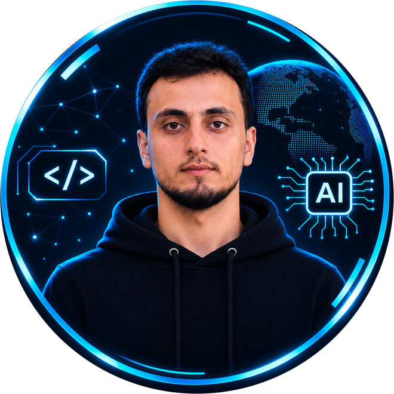
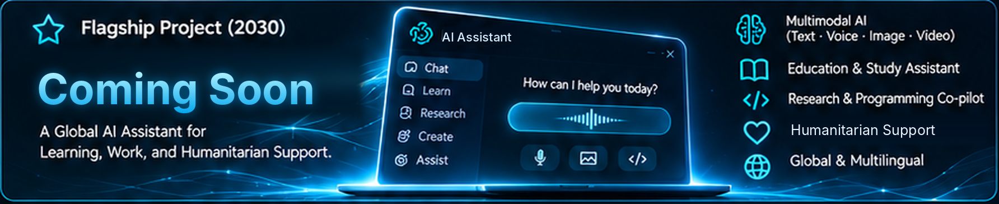
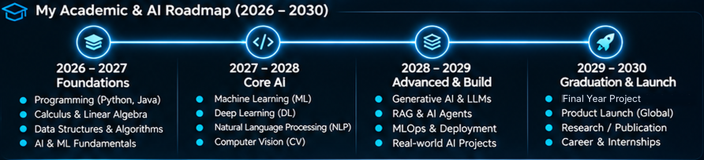

<!-- ===================== HEADER ===================== -->

 

---

## 👋 About Me

AI Engineering student. I build AI solutions, explore cutting-edge technologies, and turn ideas into real-world impact. 🚀

- 🎓 AI Engineering (1st Year)

---

## 🎯 Mission & 👁️ Vision

<table>
<tr>
<td width="50%" valign="top">

### 🎯 My Mission
To learn, build, and deploy AI solutions that solve real-world problems and create a positive impact, especially for communities in need.

</td>
<td width="50%" valign="top">

### 👁️ My Vision
To become a world-class AI Engineer, build a global AI product, and contribute to a more fair, educated, and resilient world.

</td>
</tr>
</table>

---

## 🚀 Flagship Project (2030)

> **A Global AI Assistant for Learning, Work, and Humanitarian Support.**

| Capability | Description |
|---|---|
| 🧠 **Multimodal AI** | Text · Voice · Image · Video |
| 📚 **Education** | Study assistant for students |
| 💻 **Research & Coding** | Research / Programming co-pilot |
| ❤️ **Humanitarian Support** | Technology that serves people |
| 🌍 **Global & Multilingual** | Accessible to everyone, in any language |

<!-- لما تقرر اسم المشروع وتعمل الـ repo، حط الاسم والرابط هون -->
🔗 **Project name & repository:** coming soon

---

## 🗺️ Academic & AI Roadmap (2026 – 2030)

---

## 🛠️ Tech Stack

  

---

## 📖 Currently Learning

- [x] Calculus & Mathematics
- [x] Physics for Engineering
- [x] Programming (Java)
- [ ] AI & Machine Learning (Basics)
- [ ] English (B2 → C1)
- [ ] Problem Solving (DS&A)

---

## 💡 Interests

---

## 📊 GitHub Stats

  

---

## 📈 Contribution Activity

---

